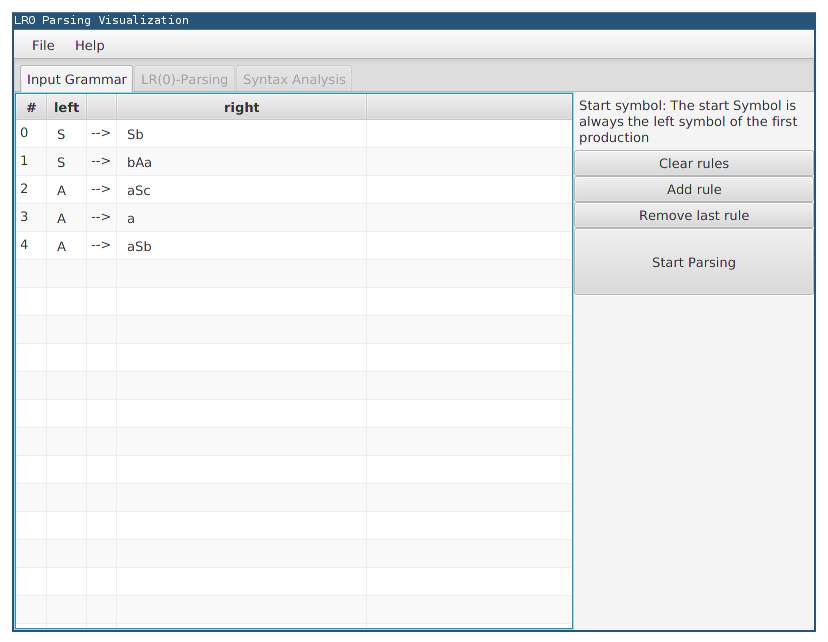
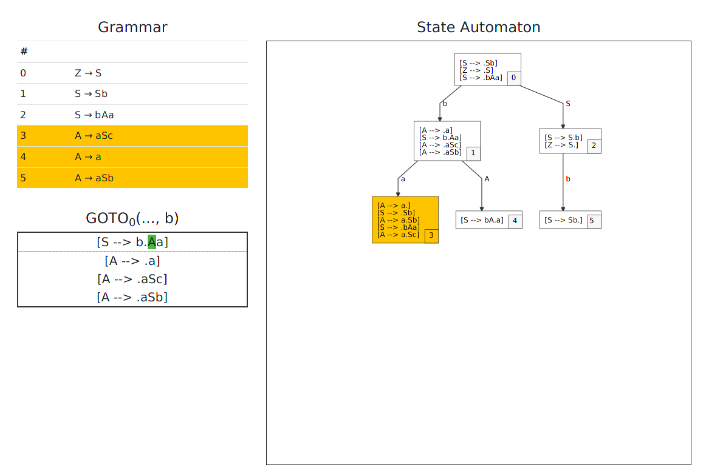
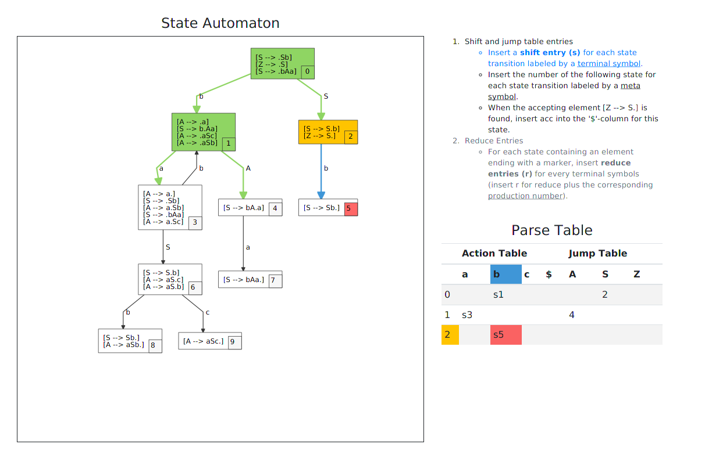
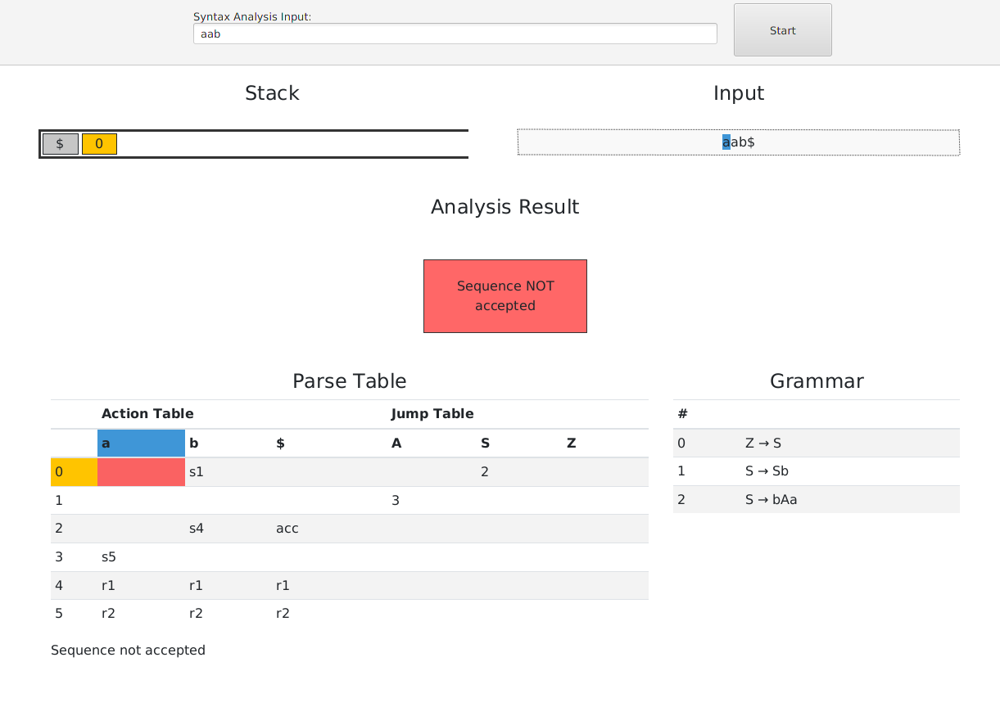

# LR0 parsing visualization

A tool to visualize the LR0 parsing as described in http://amor.cms.hu-berlin.de/~kunert/papers/lr-analyse/.
See also https://en.wikipedia.org/w/index.php?title=LR_parser&oldid=852499017.

Basic features:

* Full implementation of LR0 parsing
* Graphical user interface with the features:
  - Allows to insert, edit and remove rules of the context free grammar
  - Allows to store and load gramar to/from disk (uses json format)
  - Visualizes generation of the state automaton
  - Visualizes generation of the parse table
  - Interactive syntax analysis of sequences using the generated parse table

Use the continue button to get to the next phase. The step button can be used to see more detailled information about what happens in each phase.

## Build and run

Install a JDK (Java 25 or newer; verified with Java 27) and Maven, then build from the project directory:

```sh
mvn clean package
```

This runs the tests and creates an executable JAR with its dependencies. Start the graphical application with:

```sh
java -jar target/lr0visualization-1.0-SNAPSHOT-jar-with-dependencies.jar
```

Alternatively, run it directly through Maven:

```sh
mvn compile javafx:run
```

Maven downloads JavaFX and the JavaScript/CSS libraries used by the visualization; no separate JavaFX SDK, Node.js, or Bower installation is needed. The packaged JAR includes JavaFX native libraries for the operating system and CPU architecture used to build it. Rebuild on the destination platform if these differ. A graphical desktop session is required.





